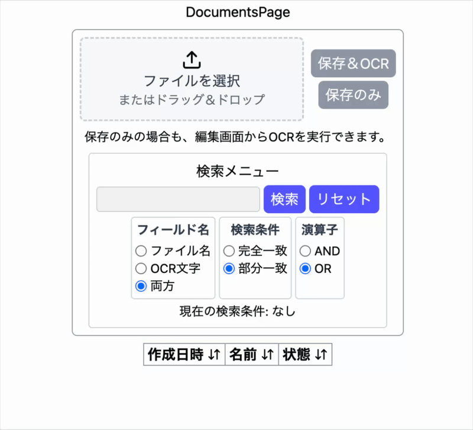
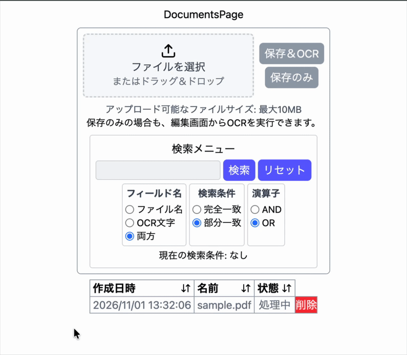
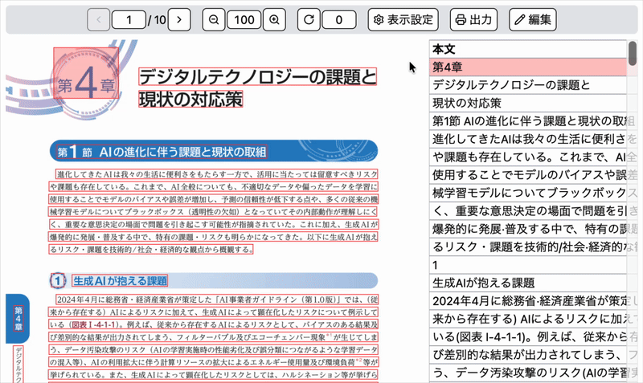
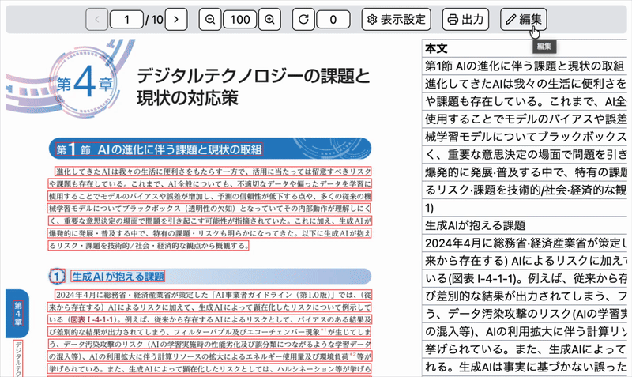
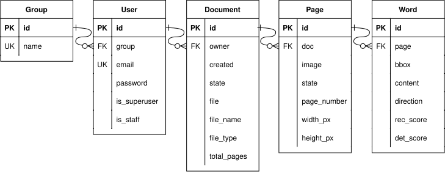
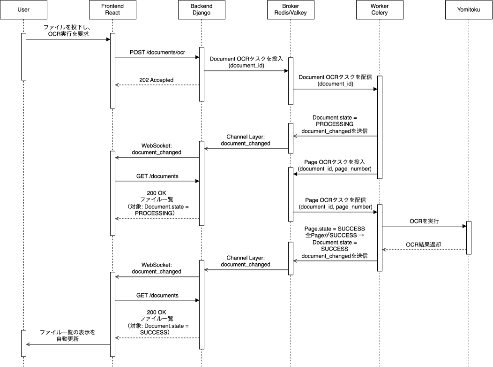
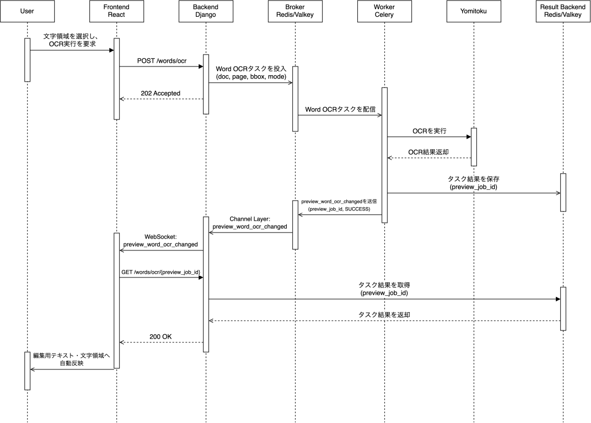
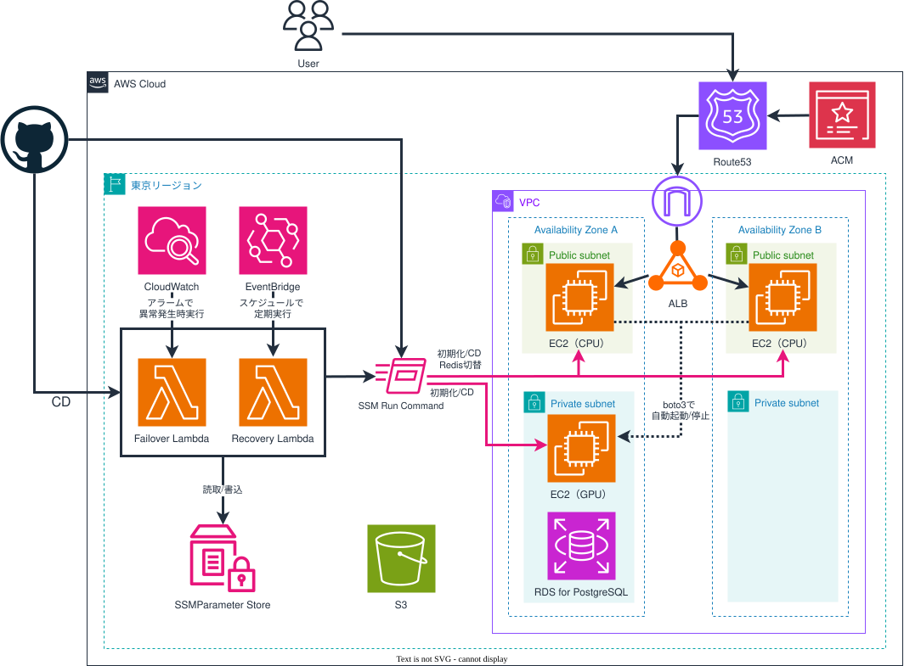

# 紙媒体の電子化支援アプリ OCR-A


## 1.概要・開発経緯

OCR-AはOCRの出力や、修正・再認識・PDF出力までを一貫して行う、電子化作業に重点を置いたOCRアプリケーションです。

開発経緯として、実行予算書・業務伺書・業務計画書を作成する際、紙媒体のスキャンデータから必要な情報を抽出し、転記する作業が日常的に発生していました。資料の読み取りと検索には、[Adobe Acrobatの「検索可能な画像」OCR機能](https://helpx.adobe.com/jp/acrobat/using/hayawakari-002.html#:~:text=%E6%A4%9C%E7%B4%A2%E5%8F%AF%E8%83%BD%E3%81%AA%E7%94%BB%E5%83%8F)を利用していました。しかし、この機能には以下の課題がありました。

- 文字範囲の検出精度とその確認方法に難点があり、調整しにくい。
  - 何もないところや、枠の柄などを検出する場合がある。
  - 検出はしているが、その枠が文字のスケールに沿ってないため、コピーしにくい時がある。
  - 検出された領域は可視化されない。選択及びドラッグが可能か、不可能かは実際に操作しないとわからないが、上記の検出の過不足と相まって操作性が悪い。
- OCRはページ単位でしか実行できず、任意の領域を指定した再OCRには対応していない。
  そのため、文字領域の検出範囲が不適切な場合でも、ユーザーが範囲を指定し直して再OCRすることはできない。
- OCR結果は、Adobeが内部で疑わしいと判定した箇所しか編集できない。
  そのため、ユーザーが発見した誤認識であっても、Adobeの判定対象外であれば修正できない。
  > Adobe Acrobatには「検索可能な画像」以外に「編集可能なテキストと画像」モードもある。このモードではOCR結果を再編集できるが、検出文字を再構築するため原本との互換性が損なわれる。

このような経緯から、単にファイルをOCRするだけではなく、そのアフターフォロー（手動修正や部分的な再OCR）を広くサポートしたOCRアプリに需要があると考え、開発に至りました。

## 2.使用方法

### ファイルの登録・OCR実行

PDF・JPEG・PNGを登録し、OCRを実行します。



### OCR完了通知・ビューアーへの移動

OCRの処理状態はファイル一覧へ自動反映され、完了後にビューアーを開けます。



### 画像ビューとテーブルビューの連動

画像上の文字領域とOCR結果一覧は、ホバー・クリック操作に連動します。



### 文字領域・本文の編集と領域指定OCR

本文の編集、文字領域の追加・削除、選択範囲への再OCRを行えます。



## 3.技術仕様

### 主要な機能と動作仕様

- **アカウント**
  - ユーザー登録・ログイン・ログアウト
  - ゲストログイン（OCR実行不可能の制限あり）
  - パスワード変更
  - アカウント削除
- **OCR**
  - ファイル単位でのOCR
  - 文字単位でのOCR（「OCR書換」「OCR置換」）
  - 日本語の横書き・縦書きに対応（文字方向を自動判別）
  - 検出信頼度／認識信頼度も同時に出力
- **ファイル登録**
  - PDF、JPEG、PNGのファイルを登録可能
- **ファイル一覧・検索**
  - アップロードしたファイルの一覧表示
  - 複合条件検索
    - フィールド名：ファイル名／OCR結果／両方
    - 検索条件：完全一致／部分一致
    - 演算子：AND/OR
  - 列基準の並べ替え（作成日時、ファイル名、OCRの状態）
  - ページネーション（10件単位で表示）
  - ファイルとOCR結果の削除
  - 一覧からビューアーへの移動

- **ビューアー**

  ビューアーは、ページ画像に文字領域を重ねて表示する「画像ビュー」と、各文字領域の情報を一覧表示する「テーブルビュー」で構成され、左右に並べて表示されます。
  - 画像ビュー
    - ページ画像を縦に並べて表示
    - 各ページ画像上に文字領域を重ねて表示
    - 文字領域のホバー時に、対応する文字を画像上へ表示
  - テーブルビュー
    - 各文字領域に対応する本文を一覧表示
    - 信頼度列（検出信頼度／認識信頼度）の表示・非表示の切り替え
    - 列基準の並べ替え（本文／検出信頼度／認識信頼度）
  - 画像ビューとテーブルビューの相互連動
    - 画像ビューの文字領域のホバー時に、テーブルビュー内の対応行を強調表示
    - テーブルビューの行のホバー時に、画像ビュー内の対応する文字領域と文字を強調表示
    - 画像ビューの文字領域のクリック時に、テーブルビュー内の対応行まで自動スクロール
    - テーブルビューの行のクリック時に、画像ビュー内の対応する文字領域まで自動スクロール
  - ボタン押下、数値入力によるページ移動・画像のズーム・回転
  - 印刷ダイアログを表示（画像とOCR文字をPDFとして保存し、アプリ外で保管可能）

- **文字領域と本文の編集**

  編集モードでは、テーブルビュー上の本文編集と、編集ツールバーを使用した文字領域の操作が可能です。
  - テーブルビューでの本文編集
    - 各文字領域に対応する本文を直接編集
    - Enterキーまたは入力欄からフォーカスを外すことで変更を確定
    - 手動で本文を変更した場合、OCRによる検出信頼度と認識信頼度を無効化
  - 編集ツールバーの選択モード
    - 「クリック選択」
      - 文字領域またはテーブルの行をクリックして選択
      - Ctrl/Command、Shiftとの組み合わせによる複数・範囲選択に対応
    - 「ドラッグ選択」
      - 画像ビュー上をドラッグし、範囲と重なる文字領域をまとめて選択
    - 「ドラッグで枠追加」
      - 画像ビュー上をドラッグして新しい文字領域を追加
      - 追加した文字領域をテーブルビューにも反映（本文編集・再OCRが可能）
  - 編集ツールバーでの操作コマンド
    - 「削除」
      - 選択した文字領域を削除
      - 複数選択時の文字領域もまとめて削除可能
    - 文字単位でのOCR
      - 「OCR書換」
        - 選択した文字領域を維持し、領域内のOCR結果で本文を書き換え
        - 複数の文字が検出された場合は、1つの本文として結合
        - 文字が検出されなかった場合も、文字領域自体は維持
        - 検出信頼度と認識信頼度は無効化
      - 「OCR置換」
        - 選択した文字領域内を再検出し、元の文字領域をOCR結果で置換
        - 複数の文字が検出された場合は、複数の文字領域へ分割
        - 文字が検出されなかった場合は、元の文字領域を削除
        - 置換後の文字領域には、新しいOCR結果の検出信頼度と認識信頼度を反映
  - Undo・Redo
    - 文字領域の追加・削除、本文の書き換え、再OCRを操作単位で取り消し・やり直し可能
    - 複数領域の削除やOCR置換による分割も、1回の操作として取り消す仕様
    - Windows：`Ctrl + Z`/`Ctrl + Y`
    - macOS：`Command + Z`/`Command + Shift + Z`
  - 編集内容の保存・破棄
    - 保存すると、追加・変更・削除した内容を反映
    - 中止すると、編集モードで行った変更をすべて破棄
    - 未保存の状態で別画面へ移動する場合は確認ダイアログを表示

- **非同期処理・非同期通信**
  - 「ファイル単位でのOCR」は先行処理中でも「待機中」として受け付け、順次実行
  - 「ファイル単位でのOCR」の状態（待機中・処理中・閲覧可能・失敗）をファイル一覧へ自動反映
  - 「文字単位でのOCR」の結果を画像ビューとテーブルビューへ自動反映

### 技術スタック

| 分類              | 技術スタック                                                                 |
| ----------------- | ---------------------------------------------------------------------------- |
| フロントエンド    | React、Vite、React Router、TanStack Query                                    |
| バックエンド      | Django、Django REST framework、Django Channels（WebSocket）、drf-spectacular |
| UI                | Tailwind CSS、Radix UI、Sonner                                               |
| DB                | PostgreSQL                                                                   |
| 非同期処理        | Celery、Redis                                                                 |
| パッケージ管理    | フロントエンド: npm<br>バックエンド: uv                                      |
| インフラ          | Docker、AWS（VPC、EC2、ALB、RDS、S3、Route53、ACM、Lambda、Systems Manager、EventBridge、CloudWatch） |
| 静的解析・整形    | フロントエンド: ESLint、Prettier<br>バックエンド: Ruff                       |
| テスト            | フロントエンド: Vitest、React Testing Library、MSW<br>バックエンド: unittest、pytest<br>Lambda関数（python）: unittest   |
| 印刷（PDF保存）   | react-to-print                                                               |
| Git hooks         | Lefthook                                                                     |
| OCRエンジン       | YomiToku                                                                     |
| CI/CD | GitHub Actions                                                               |

### ER図



### シーケンス図

#### ファイル投下時のファイル単位OCR



#### ビューアーからの文字単位OCR



### AWSインフラ構成図



## 4.設計・実装の意図等

### 主要技術の選定理由

正直に申し上げると、本プロジェクトの主要技術はビジネス要件から逆算したものではありません。QiitaやZennで紹介されているポートフォリオを参考にする中で、モダンなWeb技術を幅広く活用したいという向上心が強くなりました。そのため、難易度が高い分、成長につながるかどうかを基準に主要技術を選定しました。

- 方針の大枠
  - Backend・Frontend・DBのフルスタック構成
  - SPAによる滑らかな画面遷移・操作体験
  - REST APIによるBackendとFrontendの責務分離
  - コンテナ、CI/CD、クラウドサービスによる継続的な開発・運用体制

- Backend Python/Django + Django REST framework
  - 言語としてPythonを選択した理由は以下の通りです。
    - 学生時代から使用してきた経験があった。
    - 機械学習分野でPythonが中心的に採用されてきた実績があり、採用したOCRエンジンもPythonで構築されているため、親和性が高いと考えた。
    - 人気がありライブラリが豊富であるため、拡張性が高いと考えた。
  - フレームワークはFastAPIとDjangoの2択でした。本プロジェクトではログイン機能やAdmin管理画面、セキュリティ設定等の機能が備わっているDjangoが適切と考え、選択しました。

- Frontend JavaScript/React
  - SPAを構成できる技術を調査する中、VueとReactの2択に行き着きました。Reactは比較的難しいが拡張性があるという風潮があり、より成長が望めるReactを選択しました。

- RDB：PostgreSQL
  - Djangoが本番環境用にPostgreSQLを推奨しているため、選択しました。

- 開発・実行環境：Docker/Docker Compose
  - AIモデルの環境構築では、コンテナプラットフォームであるDockerが主流です。普段の業務でもDockerを用いて各種AIモデルの実行環境を作成していたため、本プロジェクトでも選択しました。

- CI/CD：GitHub Actions
  - 現在はGitHub Actionsが主流という風潮があり、学習価値が高いと考えて選択しました。また、ソースコードをGitHubで管理しているため、リポジトリと直接連携できる点も適していると考えました。

- クラウドサービス：AWS
  - AWS、Azure、Google Cloudの3択でした。他の選定技術とAWSを組み合わせた利用事例を目にする機会が多く、参考となる情報を得やすいと考えたため、AWSを選択しました。

### AWSインフラの設計

- **CPU用 EC2とGPU用 EC2を個別に導入**

  EC2は、常設稼働のCPU EC2と、OCR推論を行うときだけ起動するGPU EC2を個別に用意しています。CPU EC2がOCRリクエストを受け付け、処理状況に応じてGPU EC2の起動・停止を制御します。これにより、Webアプリケーションの可用性を維持しながら、GPU EC2の運用コストを抑えています。GPU EC2の停止条件は、およそ以下の通りです。
  - Redis及びCeleryに待機中・処理中のタスクが存在しない。
  - GPU EC2の起動から`GPU_WORKER_AUTOSTOP_IDLE_MINUTES`以上経過している。実装では、現在時刻から同時間を引いた`launch_time_cutoff`を求め、EC2の`LaunchTime`がその時刻以前であることを確認しています。
  - GPU EC2の起動確認処理を最後に実行した時刻に`GPU_WORKER_AUTOSTOP_IDLE_MINUTES`を加算した、`keep_alive_until`が、現在時刻以前になっている。

  これらの条件により、処理中のタスクがGPU用 EC2の停止により強制終了するということはありません。また`GPU_WORKER_AUTOSTOP_IDLE_MINUTES`の調整により、利用が活発である場合に備え、GPU EC2の再起動の待ち時間の発生を抑制することが可能です。

  時間経過によるGPU EC2の自動停止は、`keep_alive_until`によってビジネスロジック上の挙動をカバーできます。一方、CD作業のときにAWSマネジメントコンソールからGPU EC2を起動すると`keep_alive_until`が更新されないため、すぐに自動停止する場合があります。そこで、運用操作によって起動した場合にも最低稼働時間を確保するため、EC2の`LaunchTime`と`launch_time_cutoff`による判定を導入しています。
  - EC2インスタンスタイプの選定について
    - CPU EC2には`t3.small`を採用しています。AWSの無料利用枠対象となるT3系のうち、`t3.micro`はメモリが1GiBしかなく、Nginx、Django、RedisおよびCeleryをDocker上で同時に稼働させるには余裕がないと判断しました。そのため、2GiBのメモリを持つ上位の`t3.small`を選択しました。

    - GPU EC2には`g4dn.xlarge`を採用しています。[YomiToku](https://github.com/kotaro-kinoshita/yomitoku#-概要)は、通常モデルでGPUによる推論を推奨しており、VRAM 8GB以内で動作するとされています。これを最低限満たすNVIDIA GPU搭載のインスタンスタイプとして、16GiBのVRAMを持つ`g4dn.xlarge`を選択しました。

  - GPU推論環境の構築では、SageMakerでGPUを借りるといった選択肢もありえましたが、「未経験で実装するなら基本的なサービスのEC2で構築することが無難」と考えました。一方で、CPU用EC2とGPU用EC2では必要な依存関係や起動するサービスが異なるため、初期化処理とデプロイ処理を個別に構成する必要が生じました。その結果、GitHub Actionsの`workflow_dispatch`、Docker Composeのプロファイル、Parameter Storeのパスおよび環境変数をCPU・GPU用に分けることになり、CDの構成と運用が複雑になりました。この点まで含めて、SageMakerなどのマネージドな推論基盤と比較できていなかったことは反省点です。

- **CPU EC2上で稼働するRedisを本番環境でも利用**

  本ポートフォリオではRedisをWebSocket通知のチャンネルレイヤー、Celeryのメッセージブローカー、および処理結果を取得するためのResult Backendとして使用しています。本番環境では、異なるAvailability Zoneに配置したCPU EC2の構成を維持しながら、各CPU EC2上のRedisのうち一つだけを正として扱います。この構成には、Route 53のプライベートホストゾーン上に作成した固定DNS名、Lambda、SSM Parameter Storeを使用しています。ElastiCacheなどの別サービスを採用せず、既存のCPU EC2上でRedisを稼働させることで、運用コストを抑えています。

  - **Redis役割状態の定義**
    - SSM Parameter Storeの`REDIS_ROLE_STATE_PARAMETER_NAME`には次のようにCPU EC2のインスタンスIDとRedisの役割状態の組を定義します。

      ```json
      {
        "instanceId-a": "active",
        "instanceId-b": "standby"
      }
      ```

    - `active`  
      Route 53の固定DNS名の接続先となり、正として利用されている状態。
    - `fenced`  
      通信隔離とEC2の停止によって、利用できない状態。
    - `standby`  
      正として利用されていないものの、必要に応じて`active`へ昇格できる状態。  
    **障害発生時にはRedis内のキューや処理結果の破棄を許容するため、`active`とのデータ同期は行いません。**

- **Redis役割状態の遷移**

  Aをactive、Bをstandbyとし、Aに障害が発生した場合、次の手順でフェイルオーバーとリカバリーを行います。
  1. A：`active` → `fenced`
     - AのSecurity Groupを`FENCED_SECURITY_GROUP_ID`で指定した通信隔離用Security Groupへ切り替える
     - AのEC2停止を要求し、その完了を確認する
  2. B：`standby` → `active`
     - B側のCelery Maintenance WorkerとCelery Beatを起動する
       - Celery Beat：OCRタイムアウト確認とGPU自動停止判定を定期投入
       - Maintenance Worker：GPU起動要求、GPU自動停止判定、OCRタイムアウト処理を実行
     - Route 53の固定DNS名に対応するAレコードを、AからBのプライベートIPへ切り替え、完了まで待機する

  3. Redis役割状態を更新する
     - SSM Parameter Storeの`REDIS_ROLE_STATE_PARAMETER_NAME`をA：`fenced`、B：`active`へ更新する

  4. A：`fenced` → `standby`
     - AのEC2を起動する
     - RedisおよびCeleryのコンテナを削除・再作成する
     - Redis、Celery Worker、Health APIの動作を確認する
     - Security Groupを通常設定へ戻す
     - `REDIS_ROLE_STATE_PARAMETER_NAME`をA：`standby`、B：`active`へ更新する

- **Lambdaの起動契機**

  上記のRedis役割状態の遷移における、手順1～3を`Failover Lambda`、手順4を`Recovery Lambda`で実装し、以下のように実行します。
  1. 初期構築時に、以下を手動で設定
     - SSM Parameter Storeの`REDIS_ROLE_STATE_PARAMETER_NAME`に、最初に`active`,`standby`となるインスタンスidの組を設定
     - Route 53の固定DNS名に対応するAレコードに、最初に`active`となるCPU EC2のプライベートIPを設定
  2. CloudWatch AlarmでHealth APIを監視し、異常を検知した場合に`Failover Lambda`を起動する
  3. EventBridge Schedulerから`Recovery Lambda`を定期実行する
- **OCR進捗停止時の暫定的なタイムアウト処理**

  Redisのデータ消失やWorkerの障害により、OCRの進捗が停止してもドキュメントがPROCESSING（処理中）のまま残る場合があります。現時点では暫定的な対策として、OCRの活動時刻が記録されたPROCESSING状態のドキュメントを対象に、`DOCUMENT_OCR_TOTAL_TIMEOUT_MINUTES`で処理開始後の総経過時間、`DOCUMENT_OCR_PAGE_TIMEOUT_MINUTES`で最後の進捗からの経過時間を判定し、上限を超えた場合はFAILED（失敗）へ遷移させます。実行中のOCR処理は強制終了しませんが、FAILEDへの更新後に保存処理へ到達したOCR結果は保存しません。QUEUED（待機中）状態のドキュメントや、活動時刻が記録されていないPROCESSING状態のドキュメントは、現状では未対応です。

### 注目してほしい機能や設計

- 非同期処理・非同期通信による操作性の維持

  本ポートフォリオでは、処理に時間を要するOCRを実行しながら、ユーザーの操作を妨げず、処理状態を画面へ反映する必要がありました。そこで、非同期処理にはCeleryとRedisを使用し、OCRタスクをキューに蓄積してバックグラウンドで順次実行する構成としました。また、非同期通信にはWebSocketを使用し、OCRタスクの状態を画面へ自動反映しています。フロントエンドではTanStack Queryを採用し、非同期なデータ取得、キャッシュおよび再取得を管理しています。

- 編集におけるUndo/Redo機能の搭載

  Undo/Redo機能は、よくある便利機能の代表的な一つだと思います。軽い気持ちで導入を決めましたが、導入はとても大変でした。実装には、JavaScriptの`Array`、`Set`、`Map`などの標準データ構造と、Reactの`useReducer`を使用しています。当初は各技術をどのように組み合わせるかの理解が不足していたため、基礎から学び直しながらリファクタリングを重ねました。

- インフラの運用コストを抑える設計

  GPU用EC2を必要なときだけ自動的に起動・停止し、ElastiCacheを採用せずCPU用EC2上でRedisを稼働させることで、AWSの運用コストを抑えています。一方で、GPU用EC2の起動・停止制御やRedisのFailover・Recovery構成、各EC2、Lambda関数を初期化・CDするworkflowの構築などが必要となり、複雑となってしまいました。構築にあたる手間について、見通しが不十分であったことは課題です。

### 苦労した点と、その解決方法

- 苦労した点：本当に意味のあるテストの作成に困った。
- 解決方法：TDD（テスト駆動）を導入し、ユースケースを意識した総合テストを中心に据えた。

  テスト構築についてはかなりの見直しを入れています。最初はカバレッジ埋めに終始してしまい、粒度が細かいだけで、そのテストの保証するところは不明瞭という事態に陥りました。最終的には、TDD（テスト駆動開発）のサイクルと、Testing library及びその作者の「Kent C. Dodds」の思想を取り入れました。Backend・Frontend共通で、以下の点を意識しています。
  - 原則：テストケースは、実際の使用例に近いほど信頼性が高くなる
    - 「Testing Trophy」の構造で総合テストを中心に据える
    - mockはなるべく使わない
    - アレンジ（mockやpatch）の返り値の確認に徹しているだけのアサートは設けない
    - ライブラリやモジュールの基本動作を疑ってかかるようなテストは設けない

  これを踏まえ、ユースケースを意識した結合テストケースを中心として据えるようになり、バグ修正はその結合テストが通っているかをチェックする、機能追加の際はその単体テストを追加する。という方針で開発サイクルが安定し、安全性の担保もより強固になりました。もちろん、チームの開発体制やプロジェクトの性質によってテストの方針は変わりえると思いますが、自ら線引きを意識してアプリを開発する大切さを学びました。

## 5.ライセンス

本アプリケーションは、OCRエンジンとしてYomiTokuを使用しています。本リポジトリのうち、第三者の著作物を除く独自コードは、MITライセンスの下で提供します。YomiTokuのソースコードおよびモデルの重みは、CC BY-NC-SA 4.0ライセンスの下で提供されています。利用条件の詳細は、[YomiTokuのライセンス情報](https://github.com/kotaro-kinoshita/yomitoku#license)をご確認ください。
